# Connecting YouTube to Dino Visualizer

Dino Visualizer can show your YouTube playlists (they're your YouTube Music playlists too) on its **Playlists** tab. Google only shares them with apps that have a **developer key**, so you make one for yourself, once. It's free and takes about 10 minutes. You don't need a credit card or a website, and nothing here costs anything.

You'll do everything in your web browser on Google's **Google Cloud console**, then paste two codes into Dino Visualizer.

**Before you start:** sign in to your browser with the Google account whose YouTube playlists you want to see.

---

## Step 1: Make a project

A "project" is just a folder in Google Cloud for your key.

1. Open **[Create a project](https://console.cloud.google.com/projectcreate)**. If Google asks you to agree to its terms the first time, agree and continue.
2. Under **Project name**, type `Dino Visualizer` (any name works).
3. Click **Create** and wait a few seconds.

   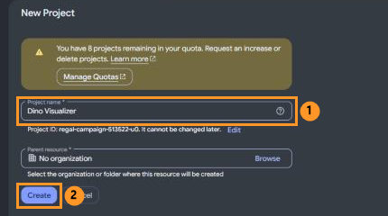

4. At the top of the page, next to the Google Cloud logo, click the project picker and make sure **Dino Visualizer** is selected. Every step below happens in this project, so check it if anything looks wrong later.

## Step 2: Turn on the YouTube Data API

This is what lets apps read YouTube playlists.

1. Open **[YouTube Data API v3](https://console.cloud.google.com/apis/library/youtube.googleapis.com)**.
2. Check the top of the page still says **Dino Visualizer**.
3. Click the blue **Enable** button. When the page changes to show charts, it's on.

   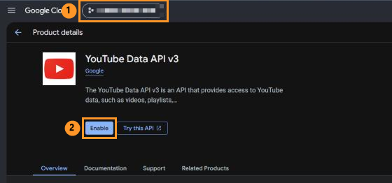

## Step 3: Set up the sign-in screen

This is the "Sign in to Dino Visualizer" page Google will show you.

1. Open **[Google Auth Platform](https://console.cloud.google.com/auth/overview)** and click **Get started**.

   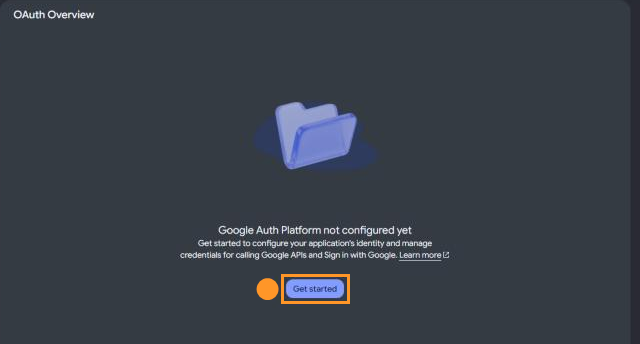

   You'll go through four short sections, clicking **Next** after each:
   - **App Information**: App name `Dino Visualizer`. For **User support email**, pick your email from the list.

     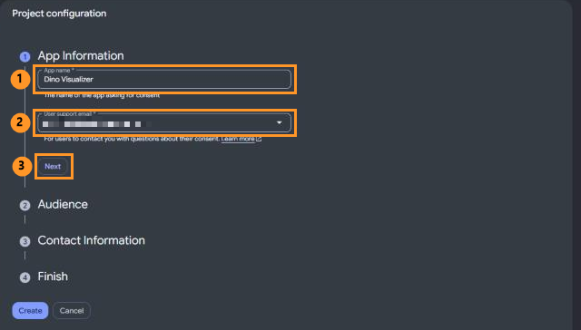

   - **Audience**: choose **External**.

     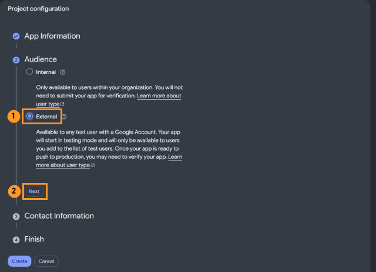

   - **Contact Information**: type your email and press Enter.

     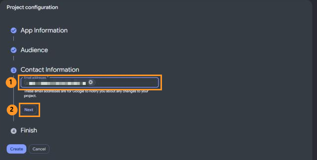

   - **Finish**: tick the box to agree to the *Google API Services: User Data Policy*, click **Continue**.
2. Click **Create**.

   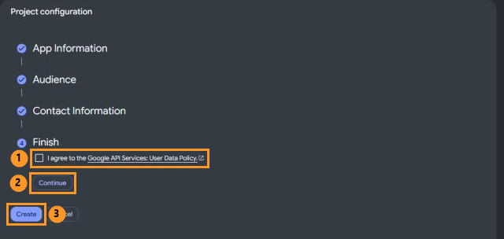

## Step 4: Add yourself as a test user

New sign-in screens start in **Testing**, where only people you list can sign in. Add yourself:

1. Open **[Audience](https://console.cloud.google.com/auth/audience)**.
2. Under **Test users**, click **Add users**.

   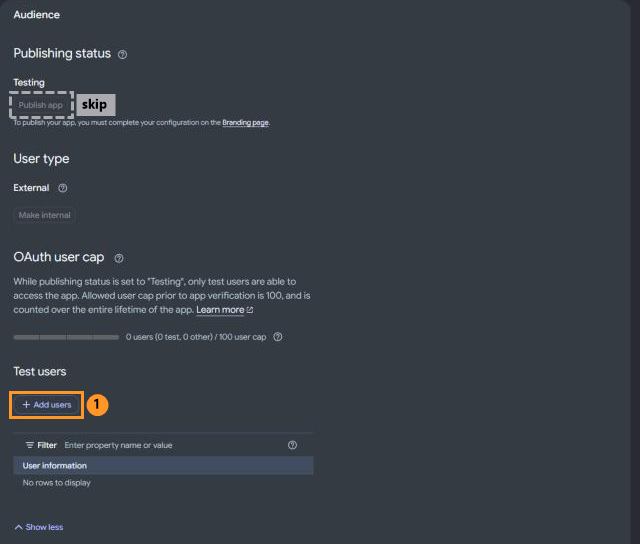

3. Type the email of the Google account with your YouTube playlists, click **Save**.

   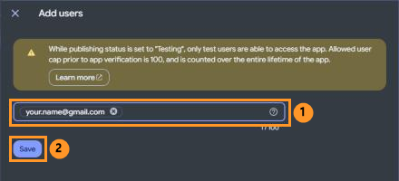

> You'll see a **Publish app** button on this page too. Skip it: Google only publishes apps that have a home page and a privacy policy, and you don't need that for your own key. Being a test user is enough.

## Step 5: Make the key

1. Open **[Clients](https://console.cloud.google.com/auth/clients)** and click **Create client**.
2. For **Application type**, choose **Desktop app**. Leave the name as it is (or call it Dino Visualizer) and click **Create**.

   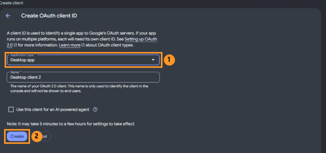

3. A box appears with your **Client ID** (a long code ending in `.apps.googleusercontent.com`) and **Client secret** (starting with `GOCSPX-`). Each has a copy button next to it.

   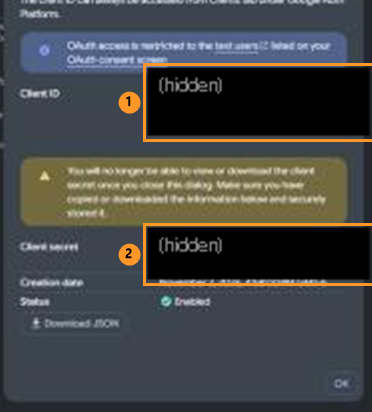

> **Keep this box open.** Google only shows the Client secret once. If you close it by mistake, open the client from the Clients list and click **Add secret** to make a new one.

## Step 6: Connect in Dino Visualizer

1. In Dino Visualizer, open the **Playlists** tab and click **YouTube: Connect**.
2. Copy the **Client ID** from Google's box (there's a copy button next to it) and paste it into the **Client ID** box.
3. Do the same for the **Client secret**.

   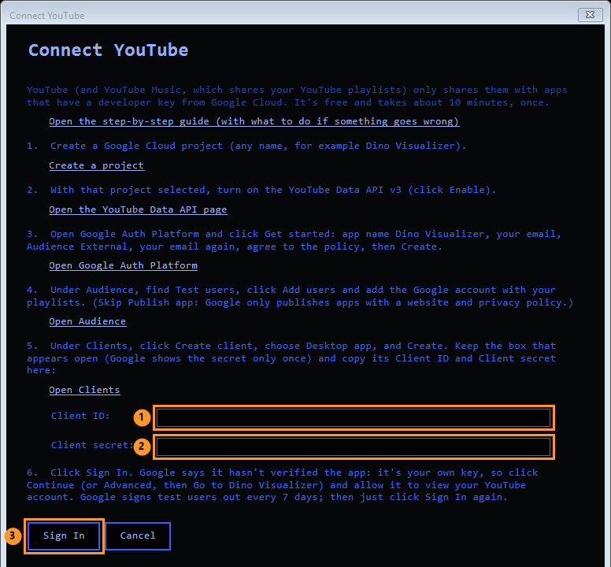

4. Click **Sign In**. Your browser opens Google's sign-in page:
   - Pick your Google account. If your YouTube channel is a **brand account**, pick that channel when Google asks.
   - Google says **"Google hasn't verified this app"**. That's expected, because it's your own key. Click **Continue** (on some screens it's **Advanced**, then **Go to Dino Visualizer**).
   - Allow **View your YouTube account**, then click **Continue**.
5. The browser says you can go back to the app, and your playlists appear on the Playlists tab with red **YT** badges.

You're done. You don't need to do any of this again on this PC.

---

## If something goes wrong

| What you see | What to do |
|---|---|
| **"Access blocked: Dino Visualizer has not completed the Google verification process"** (error 403: access_denied) | Your account isn't on the test list. Do **Step 4** with the exact Google account you're signing in with. |
| **"Google hasn't verified this app"** | Normal for your own key. Click **Continue** (or **Advanced**, then **Go to Dino Visualizer**). |
| **"YouTube Data API v3 has not been used in project … or it is disabled"** | Do **Step 2** again, and check the top of the page shows the same project your key is in. |
| **"invalid_client"** or **"The OAuth client was not found"** | The Client ID or secret was pasted wrong, with an extra space or a missing letter. Click **YouTube: Sign In** again: the window opens with what you pasted, so you can fix it. |
| **No playlists, or the wrong ones** | You may have signed in with a different Google account or channel. Click the YouTube button, **Sign Out**, then sign in again with the right one. |
| **"YouTube signed you out; sign in again"** after about a week | Google signs test users out every 7 days. Click **YouTube: Sign In**: your key is already filled in, so just click **Sign In** and approve in the browser. |

**Is this safe?** The key belongs to you, and only your Dino Visualizer uses it. Dino Visualizer only asks to *read* your YouTube account (to list your playlists and their songs), never to change anything. Google's own page handles your password, so the app never sees it. Your key and sign-in are saved encrypted for your Windows account, and **Sign Out** removes the sign-in.
